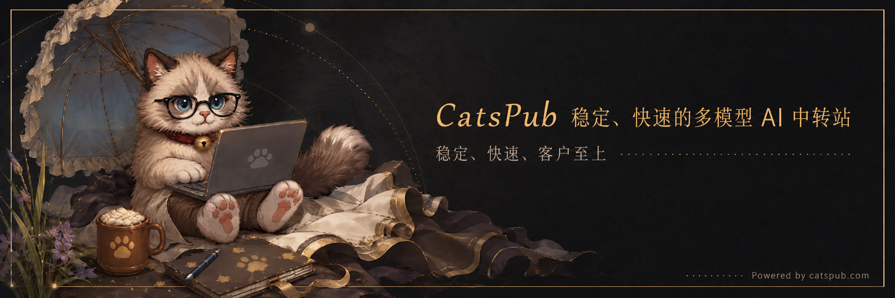

<div align="center">


# 🛠 BubbleFighter CN0261 Server 🛠

**面向 BubbleFighter CN0261 客户端的 Windows C++20 服务端实现**

本地账号 · 角色与背包 · 商店与广场 · 多人房间 · 对局与结算 · TLS 认证与 Relay


[](LICENSE)


[快速上手](#快速上手) · [构建指南](docs/build.md) · [运行与接入](docs/usage.md) · [开发约定](docs/development.md) · [编译与发布](docs/ci.md)

<table aria-label="community">
<tr>
<td align="center" width="280"><a href="https://qm.qq.com/q/fAcNMJVyuI"><br><strong>加入 泡泡战士 K1ro 服社区</strong></a></td>
<td align="center" width="280"><a href="https://afdian.com/a/K1roSama1337"><br><strong>通过 爱发电 支持我们！</strong></a></td>
<td align="center" width="280"><a href="https://ko-fi.com/k1rosama"><br><strong>请我们喝杯咖啡！</strong></a></td>
</tr>
</table>

<table aria-label="CatsPub AI">
<tr>
<td align="center" width="840">
  <a href="https://catspub.com">
    <br />
    <strong>本项目由 Catspub 中转站获得支持</strong>
  </a><br />
  <sub>稳定 · 快速 · 用户至上</sub>
</td>
</tr>
</table>

</div>

## 感谢两位的慷慨付出

向本次促进开源推进的人表达感谢 ^ ^

没有你们的弱智发言，我们也不会加快工作进度。

**希望你们清楚，你们永远要为自己的发言负责，无论处于什么身份和地位。**

<details>
<summary>开源原因 | <b>⚠️多图预警/降智预警⚠️</b> </summary>

### 懒惰、贪婪

<blockquote>
  <p>"作为一名开发，我不应该考虑每个不同地区玩家的延迟最大程度缓解？现在的你，跟你之前的话，越发会发现你就是一个小丑，毕竟我可不需要披着别人的身份在网上装大王，最后再说一句脏话，你们两个傻逼就只会在自己那里舔韩国人当大王了。"</p>
  <p align="right">
    <sub>—— <strong>K1ro</strong> · 2026-10-12</sub>
  </p>
</blockquote>


### 傲慢、暴怒

<blockquote>
  <p>"你跟那个喜欢伪造他人的小丑一样，总把自己摆在一个很高的位置上，结果你也不知道自己什么能力，没有一个人看得起你，只会没有任何事实依据的情况下想办法去抹黑他人。你的行为跟你说的话倒是符合了你从其他某国学来的特征，我不接受你的道歉，同时还你一句闹麻了。"</p>
  <p align="right">
    <sub>—— <strong>K1ro</strong> · 2026-10-12</sub>
  </p>
</blockquote>


</details>

## 项目介绍

这是面向 CN0261 客户端的 Windows 控制台服务端，使用 Boost.Asio 协程、Boost.MySQL、OpenSSL 和 MySQL。源码覆盖本地账号与一次性登录票据、角色和库存持久化、商店、聊天、广场、多人房间、对局状态及奖励结算。

仓库提供本地认证与启动脚本，**不包含游戏客户端或资源文件**。启动脚本只接受已固定 SHA-256 的 CN0261 原始客户端，不承诺支持其他版本；接入步骤见[运行与客户端接入](docs/usage.md)。

| 功能 | 源码覆盖的流程 |
| --- | --- |
| 本地账号 | 创建账号、密码验证、签发与消费一次性登录票据 |
| 角色与库存 | 角色创建与加载、背包、装备和武器预设 |
| 商店与升级 | 商品购买、余额更新、经验升级和奖励 |
| 房间与广场 | 房间创建与加入、准备、房主变更、广场成员与聊天 |
| 战斗与结算 | 开始对局、攻击与伤害、泡封与救援、复活、结果与奖励写入 |
| 客户端接入 | 启动器 TLS 认证、隔离客户端运行目录与 Relay 连接 |

## 快速上手

先完成[构建与数据库准备](docs/build.md)，再在仓库根目录执行。配置校验不需要数据库，也不会检查数据库连接：

```powershell
$server = '.\Artifacts\Bin\x64\Release\BubbleFighter_CN0261_Server.exe'
& $server --check-config
```

预期输出：

```text
Configuration is valid. Database connectivity has not been checked.
```

使用自己的数据库连接配置启动。密码通过环境变量传入，`Local/server.json` 为[构建指南](docs/build.md#数据库与配置)中创建的私有配置：

```powershell
$credential = Get-Credential -UserName bubblefighter_server -Message '输入 MySQL 运行账号密码'
$env:BF_DATABASE_PASSWORD = $credential.GetNetworkCredential().Password
& $server --config .\Local\server.json
```

数据库和 14 份迁移通过校验后，日志出现 `[Application] ready port=26100 protocol=cn0261-ticket-login`。客户端登录还需要创建游戏账号、启用 TLS 认证并配置启动器，详见[运行指南](docs/usage.md)。

## 构建与部署

要求 Windows x64、MSVC v143、Windows SDK `10.0.26100.0` 和 Python 3.12+。vcpkg 通过 [vcpkg.json](vcpkg.json) 的固定 baseline 安装依赖，默认从 Visual Studio 查找 vcpkg，也可设置 `VCPKG_ROOT`。

```powershell
git clone https://github.com/K1roSama/BubbleFighter_CN0261_Server.git
cd .\BubbleFighter_CN0261_Server
./build/build.ps1 -Configuration Release
```

也可在 Visual Studio 中打开 [BubbleFighter_CN0261_Server.sln](BubbleFighter_CN0261_Server.sln)，选择 `Debug` 或 `Release`、`x64` 后构建。依赖、数据库 TLS 与迁移说明见[构建指南](docs/build.md)。参与开发时，另按[开发约定](docs/development.md)安装 LLVM `22.1.8` 并执行格式与命名检查。

## 使用限制

- 面向固定 CN0261 客户端；源码实现范围不等于原版服务端的全部内容，不承诺其他版本兼容。
- 必须自行提供 MySQL 和客户端；服务端不会自动初始化数据库或执行迁移。
- 房间、广场和在线连接保存在进程内，重启后需要重新连接；角色、库存、商店与结算通过 MySQL 持久化。
- 角色数值、商店目录、升级奖励和战斗配置是本项目的本地策略，不能据此认定原版规则。
- CI 的离线回归、配置校验和失败启动检查不等于真实数据库或客户端联机验收。

## 文档与贡献

| 文档 | 内容 |
| --- | --- |
| [构建指南](docs/build.md) | 工具链、依赖、数据库迁移与 TLS 配置 |
| [运行与客户端接入](docs/usage.md) | 命令行、账号、票据、认证证书、启动器与监听配置 |
| [开发约定](docs/development.md) | Google C++ 风格、目录、命名、兼容边界与检查命令 |
| [编译与发布工作流](docs/ci.md) | 自动构建、诊断日志、手动发布和本地复现 |

欢迎通过 [Issues](https://github.com/K1roSama/BubbleFighter_CN0261_Server/issues) 反馈问题或提交 Pull Request。请附客户端版本、服务端提交、复现步骤与日志，并先移除密码、私钥和登录票据。

## 许可证

本仓库采用 [MIT License](LICENSE)。第三方依赖的许可随发布包提供。
